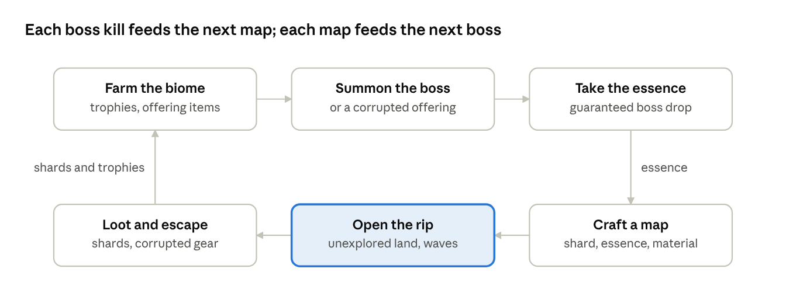

# Valheim Corruption Mod — Design Doc

Oct 15, 2026 · @Krogon

> Converted from the PDF design doc written in a separate brainstorming session. The content is unchanged apart from formatting. Technical review notes are kept separately in [`corruption-design-review.md`](corruption-design-review.md).

## Overview

A Diablo/Path of Exile-style endgame layer for Valheim: farm bosses to craft maps, open rips into unexplored parts of your own world, and loot rolled gear to corrupt. Built on BepInEx, reusing vanilla systems wherever possible.

### Design pillars

- **The world is the dungeon.** Maps send you to real, unexplored terrain in the seed, not instanced boxes.
- **Extend vanilla, don't fight it.** Bosses already gate biomes; recipes already unlock by pickup. Build on both.
- **Reuse before you create.** Stat tweaks, existing summons, status effects, the raid system and material tints over new animations, VFX or art.
- **Risk buys reward.** More corruption means more danger and better loot, at every layer.
- **Viking lore for names.** Every new item or system gets a Norse name where one fits.

### Build constraints

- BepInEx plugin, likely with Jötunn for items, recipes and pieces; Harmony patches for behaviour changes.
- No new animations or attack types in v1. No new 3D models; tints and reused particles only. *Exception (user, 2026-10-28): the corruption shard has its own crystal model and texture.*
- Vanilla recipe-unlock rules: a recipe appears only once the player has picked up every ingredient.
- Must work in multiplayer (dedicated server). Decisions below note where that matters.

## Core loop

*Each boss kill feeds the next map; each map feeds the next boss.*

1. **Farm the biome**: trophies, offering items.
2. **Summon the boss**, or a corrupted offering.
3. **Take the essence**: guaranteed boss drop.
4. **Craft a map**: shard, essence, material.
5. **Open the rip**: unexplored land, waves.
6. **Loot and escape**: shards, rolled gear (Magic, Rare, Unique). Shards and trophies go back into step 1.

The loop runs once per biome. The essence from a biome's boss crafts maps into the corrupted version of that same biome, so beating a boss opens its biome's endgame, and moving on to the next biome's corrupted maps needs the next boss. *Changed 2026-10-28 (user): was "maps for the next biome up", which left no corrupted Meadows and gave the last boss's essence nowhere to go.* Shards and trophies from the rip feed the talisman bench and corrupted boss summons, so every piece connects.

## Corruption shards

The shard is the mod's currency. It unlocks the map bench, is an ingredient in every map, corrupts boss summons, and rolls affixes onto maps.

### Sources

| Source | Rate | Why |
|---|---|---|
| 1-star and 2-star creatures | Low chance, higher for 2-star | Rewards normal play; gives players their first shard without a map |
| Every boss, first kill | Guaranteed, 1–3 shards | Makes sure the loop can start after the first boss |
| Rip waves and rip chests | Main source | Keeps players running maps |
| Vanilla dungeon chests (crypts, burial chambers) | Rare | Optional; adds a reason to revisit dungeons |

### Uses

- Picking up the first shard unlocks the map bench recipe (vanilla-style pickup unlock).
- One shard per map recipe.
- Combined with a boss offering (e.g. a deer trophy) into a corrupted offering that summons the corrupted version.
- Extra shards at the bench roll affixes onto a map (see [Map affixes](#map-affixes-and-tiers)).

**Open point:** shards in the rip should scale with map tier so higher maps are the best shard farm, not Eikthyr runs.

## Boss essences and the biome chain

Each boss drops a new item, its essence, which is the key ingredient for maps into the corrupted version of its own biome. Using a new drop instead of the vanilla trophy or antler keeps vanilla recipes untouched and gives full control over drop rates.

| Boss | Essence (working name) | Crafts maps into | Biome material for the recipe |
|---|---|---|---|
| Eikthyr | Essence of Eikthyr | Meadows | Deer hide (proposed) |
| The Elder | Essence of the Elder | Black Forest | Greydwarf eye |
| Bonemass | Essence of Bonemass | Swamp | Guck |
| Moder | Essence of Moder | Mountains | Freeze gland |
| Yagluth | Essence of Yagluth | Plains | Needle |
| The Queen | Essence of the Queen | Mistlands | Carapace or Soft tissue |
| Fader | Essence of Fader | Ashlands | Flametal or Charred bone |
| Kall Fimbulbringer | Essence of Kall Fimbulbringer | Deep North | Timberwood (proposed) |

The Hive (an unused Mistlands boss, console-spawn only, in the 1.0 game files) is left out on purpose; maybe revisited later (user, 2026-10-28). Names, colours and drop counts: [`Corruption/Data/essences.csv`](../Corruption/Data/essences.csv).

### Rules

- Normal kill: 1 essence. Corrupted kill: 2–3 essences plus corrupted loot.
- Essences are not tradeable at vanilla vendors and have no other recipe use, so they can't be farmed for anything but maps.
- The chain means a corrupted Ashlands map needs Fader dead first. No skipping biomes: each biome's corrupted maps need that biome's boss.

**Open point:** the Meadows, Mistlands, Ashlands and Deep North materials are placeholders; pick whichever drops earliest in that biome so the recipe is easy to unlock.

## Map bench and map recipes

The map bench is a new crafting station, unlocked by picking up the first corruption shard. It crafts maps, rolls affixes onto them, and crafts corrupted boss offerings. Working name: **Riftforge** (named for the rips its maps open).

**Bench recipe:** Fine wood, Corruption shard, Eikthyr trophy, Bronze nails, Surtling cores. Needs a workbench nearby, same as other vanilla stations. Amounts to be set during tuning.

*Changed 2026-10-15: was "a boss trophy of any kind", which a single vanilla recipe can't express. Now Eikthyr's trophy, plus nails, leather scraps and cores. Bronze nails and Surtling cores keep the bench at the Black Forest stage, the same point where fine wood (bronze axe) already puts it.* *Changed 2026-10-26: Leather scraps dropped, because Valheim building pieces support at most 5 ingredients.*

**Map recipe pattern** (every map follows it):

1. 1 Corruption shard
2. 1 Boss essence (the target biome's own boss)
3. A small stack of the target biome's material (see the essence table)

All three must have been picked up before the recipe appears, which is vanilla behaviour. In practice the map unlocks the moment you kill the biome's boss (you already hold its material by then).

### Map item

- Stackable? No. Each map is a single item so affixes can live on it.
- Consumed on use. Kept in the normal inventory for now (1 per slot); the Maps tab comes with the inventory work in phase 9 (2026-10-28).
- Tooltip shows target biome, tier, and any rolled affixes.
- Teleportable through portals (it's the key to the content, not a resource).

## Rips

Using a map opens a rip: a portal to an unexplored spot in the player's own world. Arriving tears the local area open, drawing nearby creatures to the player and maddening them.

### Activation

1. Player uses the map item.
2. The mod picks a landing spot (below) and spawns a rip portal next to the player.
3. Walking through teleports the player (and anyone else who follows within the open window).
4. On arrival a second rip opens at the landing spot. This is the encounter anchor and the way home.

### Picking the landing spot

- Only terrain the activating player has not explored, read from their minimap explored data.
- Only the map's target biome. A Black Forest map never lands you in Ashlands or open ocean.
- Meadows maps follow the same unexplored-land rule as every other map. The user expects plenty of unexplored Meadows to remain by the time the first corrupted map is crafted (decided 2026-10-28; revisit only if rips fail to find a spot in play-tests).
- Prefer land at least a set distance from the player's bases (no ward or bed nearby) so rips don't trash a build.
- The area isn't loaded until arrival, so validate the spot after the zone loads and re-roll if it's water or a cliff face.
- Multiplayer: the activator's explored data decides. Others may already know the area; that's fine.

### The encounter

- Waves come from the mod's own wave spawner, driven by the rip's heart, with the map's biome creatures and a raid-style on-screen message. *Changed 2026-10-28: was the vanilla raid system, which runs one raid at a time for the whole world.*
- Spawns are **maddened**: a status effect that boosts damage and speed, disables fleeing, and ignores faction rules so creatures fight each other too.
- Star level is pushed by map tier (see [Map affixes](#map-affixes-and-tiers)).
- A rip chest or drop at the end holds the guaranteed loot.

*Built 2026-10-28 (step B), from the game data and the user's answers:*
- **Waves are the biome boss's army:** the game's own raid(s) that stop once that boss is defeated (Eikthyr → army_eikthyr … Kall Fimbulbringer → army_elakingar and army_jotuns), with their own creatures, counts, intervals, chances and group sizes. They start when a player comes within the raid's range (96 m), with the raid's own start message, and keep coming **while the heart stands**.
- When the waves start, every creature already within that range is **maddened** and hunts the players.
- **Maddened:** damage from Dvergr power (the game's creature buff, ×1.2), speed from the Tonic of Ratatosk (+15%), no fleeing, enemies of everything; **charms don't repel them** (user).
- **Stars:** up to 2 (tier 1), rolled with the game's own level-up chance.
- **End loot:** destroying the heart leaves one of the biome's own vanilla chests (weighted by how often each appears there; `Corruption/Data/rip_loot.csv`) with 1–3 corruption shards added (user). Rip creatures drop shards at **twice** the normal starred chances (user).

### Getting home

The rip's heart is a destructible object **96–128 m from the landing spot** (just outside the waves' 96 m range), so players have to go and find it; the waves start as they close in. *Changed 2026-10-29 (user): it was at the landing spot.* Destroying it opens the return rip home.

**Corrupted wishbone** (user, 2026-10-29): crafted at the Riftforge from a Wishbone and 1 shard. Worn, it pings towards the heart of the rip you came through, like the vanilla Wishbone finds buried treasure, in red and purple, faster the closer you get (the vanilla pacing: 5 s far, 0.5 s close). Everyone nearby sees the pings. Since the Wishbone drops from Bonemass, early rips are searched without it (the user's choice).

**Decided: heart-gated return.** Both rip portals close after 1 in-game day. There is no safety fallback: survival games reward preparation, so a player who arrives without a plan for getting home (a portal kit, food, repairs) and dies or is stranded pays the price.

### Lingering scars

After a rip closes, the area stays corrupted for a few in-game days: tougher spawns, corrupted versions of resources, a small shard trickle. The player's world slowly gains dangerous zones they created themselves. Scars show on the minimap as a marker.

**Lore:** rips are cracks toward Ginnungagap, the primordial void. On-screen text can lean on that.

## Map affixes and tiers

Affixes are the Path of Exile part: spend extra shards at the bench to roll modifiers onto a map. More affixes means more danger and more reward. Every affix below reuses a vanilla status effect or stat, so none needs new art.

### Tiers

| Tier | Set by | Effect |
|---|---|---|
| 1 | Base map | Vanilla spawns, up to 2-star |
| 2 | 1 extra shard | More waves, 2-star guaranteed on some |
| 3 | 2 extra shards | 3-star creatures appear (above vanilla cap) |
| 4 | 3 extra shards + a boss trophy | 3-star packs, a maddened mini-boss, best loot |

### Affix pool (roll 1–3)

| Affix | Vanilla effect reused | Danger | Reward |
|---|---|---|---|
| Frostbitten | Freezing status the whole run | Stamina drain, slow | More shards |
| Drowned | Wet status, rain | Lower fire, slower stamina regen | More trophies |
| Smouldering | Burning on hit from all creatures | Damage over time | Better gear rolls |
| Choking | Smoke effect in the area | Visibility, damage | More essence chance |
| Swarming | Doubles spawn count | Overwhelm | More drops overall |
| Hardened | Creatures take 30% less damage | Longer fights | Higher rarity floor |
| Rabid | Maddened effect doubled | Faster, harder hitting | Guaranteed 3-star |

### Rules

- Rolling is random from the pool, with a reroll costing one more shard. This is the shard sink. Rolling map affixes never bricks the map; the 25% brick chance applies to gear only.
- Affixes stack with tier. A tier-4 Rabid-Swarming map is meant to be a near-death experience.
- Numbers above are starting points for tuning, not final.

## Corrupted bosses

A corrupted boss is the vanilla boss with its numbers turned up and its summons turned on. No new attacks or animations. The visual is a tint and reused particles.

**Summoning:** offer a corrupted version of the boss's normal offering, e.g. a Corrupted deer trophy for Eikthyr. One item, same altar, same ritual, harder fight. Corrupted offerings are crafted at the Riftforge from the normal offering plus 1 Corruption shard. *Clarified 2026-10-28: the recipe takes the full normal offering (the altar's item and count, e.g. both deer trophies) plus 1 shard; the one corrupted item then summons the boss. The Queen, who has no altar, is corrupted with a corrupted Sealbreaker (Sealbreaker + 1 shard) used on her door.*

### Changes over the vanilla boss

| Change | How | Starting value |
|---|---|---|
| Hits harder | Damage multiplier on all attacks | 1.5x |
| Takes less damage | Armour or damage-taken multiplier | 0.7x damage taken |
| Summons | Periodic spawn of the boss's own biome creatures, maddened | Every 30 s, 2–3 creatures |
| Look | Red tint via material colour (the shard's red; was purple, changed 2026-10-28), plus Bonemass poison cloud or Ashlands ember particles | — |
| Health | Unchanged in v1; damage reduction already lengthens the fight | 1.0x |

### Summons by boss (all already in the game)

- Eikthyr: boars, necks
- The Elder: greydwarfs, greydwarf brutes
- Bonemass: blobs, draugr
- Moder: drakes, wolves
- Yagluth: fulings, fuling berserkers
- The Queen: seekers, seeker soldiers
- Fader: Ashlands creatures, TBD

### Loot on kill

- 2–3 essences instead of 1
- Guaranteed shards (3–5)
- Low chance at the boss's unique item (see [Loot and uniques](#loot-and-uniques))
- Normal vanilla drops as well

**Escalation (optional, later):** each corrupted kill in a row within a world-day tiers up the next summon's multipliers slightly. Push your luck for better drops.

## Exploration and world events

Three systems that keep the open world worth roaming after the maps are running.

### Roaming rare elites (from WoW)

- Each biome has a few named elites, e.g. Grimbark the Elder Greydwarf or Svartbristle the Boar.
- One can be active per biome at a time, wandering a set area. It respawns several game days after it's killed.
- Built from the vanilla creature with 2-star scaling plus a damage and health bump, a name above its head, and the corrupted tint. No new attacks.
- A minimap ping appears when a player gets within about 50 m, so exploring is what finds them.
- Guaranteed Rare item on kill, and 2x base unique chance.

### Terror zones (from Diablo 2)

- Old rip sites come back. When a rip's scar fades, the site joins a pool. Each game day, one site from the pool reactivates as a terror zone.
- Terror zones spawn tougher creatures (+1 star), drop more shards, and count as a tier 2 rip for unique chances.
- Marked on the minimap with the day's terror zone announced on screen, so the group knows where to go.
- Pulls players back into biomes they've outgrown, with loot worth the trip.

### Secret map: Svartalfheim (Diablo 2's Cow Level, through Norse myth)

- Svartalfheim is the realm of the dwarves who forged Draupnir and Brisingamen. Valheim's Dvergr are already dwarves, so the realm reuses their creatures, buildings and props.
- The recipe is never hinted. It appears only when a player has picked up every ingredient, which vanilla's unlock rule handles for free. Proposed ingredients: a Black core, an Essence of Yagluth, a Corruption shard, and something oddly out of place, like a Dandelion.
- The rip lands in an unexplored Mistlands area where every spawn is a maddened Dvergr, ending at a dwarven treasure vault.
- Vault loot is weighted toward rings and uniques tied to dwarven myth.
- Other realms (Alfheim, Jotunheim, Helheim) can become further secret maps later.

## Talismans

A trophy talisman fully repels one creature type: it won't target, chase or attack the wearer. The point is quality of life. Once you've outgrown a biome, its trash mobs stop being a chore. Talismans are also the first thing to build: self-contained, and they exercise items, recipes and AI hooks.

**Recipe pattern:** 3 of the creature's trophy, 1 Chain (from the Swamp), 10 Leather scraps. Crafted at the workbench (the vanilla gear bench), not the map bench. Each creature type has its own recipe, which unlocks once the player has picked up all of its ingredients. Because Chain comes from the Swamp, trophy talismans arrive mid-game, after the early biomes are mastered.

### Effect: full repel

The matching creature type ignores the wearer completely. Other creatures, and other players without the talisman, are unaffected.

- A talisman covers the creature's family where that makes sense, e.g. the Greydwarf talisman covers greydwarfs, brutes and shamans.
- If the wearer attacks a repelled creature, it fights back as normal for that encounter.
- Talismans don't work inside rips. Maddened creatures ignore them.

Bosses have no talisman.

**Slots:** ~~one trophy talisman equipped at a time.~~ *Changed 2026-10-28:* **two talismans and one vanilla trinket** can be worn together; talismans have their own slots (added to EquipmentAndQuickSlots' equipment panel). Other talisman types with different effects will come later and are separate from this one (details TBD).

**Lore name:** Ægishjálmur charms (the Helm of Awe, a stave said to strike fear into enemies). Each charm could carry the stave as its icon with a creature-specific tint.

### Examples

| Talisman | Trophies | Repels |
|---|---|---|
| Greydwarf talisman | 3 Greydwarf trophies | Greydwarfs, brutes, shamans |
| Draugr talisman | 3 Draugr trophies | Draugr, draugr elites |
| Wolf talisman | 3 Wolf trophies | Wolves |
| Fuling talisman | 3 Fuling trophies | Fulings, berserkers, shamans |

All talismans also take 1 Chain and 10 Leather scraps.

**Rings:** rings get their own equipment slot, separate from talismans. Their effects centre on raising skill levels, for example +10 Axes or +15 Run. Lore rings like Draupnir fit here; see [Loot and uniques](#loot-and-uniques).

## Other systems

These came from the original brainstorm. They're worth doing but are not part of the core loop, so they sit after it in the build order.

### Wheel of powers

- Extend the vanilla Forsaken power radial to include powers granted by equipped items.
- Item powers: a strength belt (large carry-weight boost), a lightning ring from Eikthyr, and so on.
- Vanilla's Megingjord already uses Thor's belt name, so the power belt needs another: Brisingamen (Freyja's necklace) or a plain "Jotun Girdle".

### Inventory and equipment slots

- Dedicated equipment slots for talismans and rings, so they don't eat bag space. Two extra tabs off the main player inventory: a Currency tab (orbs, shards, Affix Splinters, runes) and a Maps tab. Affix Splinters don't stack, so they need the Currency tab (user, 2026-10-28).
- WoW-style backpack with tabs is UI work on top of existing extended-inventory approaches. Check compatibility with popular inventory mods before building; it may be better to depend on one than to compete.
- *Decided 2026-10-28:* the group uses **AdventureBackpacks** for backpacks (it has its own models and textures) instead of us building one, and **EquipmentAndQuickSlots** for equipment slots. See [`mod-compatibility.md`](mod-compatibility.md).

### Skill rework

- Replace use-to-level with player levels and spendable stat points.
- Most invasive change in the list: vanilla reads skill values across combat, crafting and movement. Do it last, and consider shipping it as a separate optional module.
- Compare against EpicMMOSystem before building; it covers much of this ground.

## Loot and uniques

Corrupted loot is what keeps people running maps and farming bosses. Two layers: corrupted versions of normal gear, and rare uniques with a lore name and a build-defining effect.

### Corrupted gear

- **Corrupted gear only comes from using a shard** *(user, 2026-10-28)*: nothing drops already corrupted. The first draft's "vanilla gear dropping with a corrupted tint and 1–2 bonus affixes" is dropped; it predates the rarity model.
- Rip chests and corrupted bosses drop ordinary rolled loot (Normal, Magic, Rare, Unique); map tier sets the affix count and the rarity floor.
- **Corrupting at the Riftforge** *(decided by the user 2026-10-28)*: put a Normal, Magic or Rare item and 1 Corruption shard in the bench. One of three things happens:

  | Outcome | Chance | Result |
  |---|---|---|
  | Bricked | 25% | The item is destroyed |
  | Unchanged | 25% | Nothing added, but the item is now corrupted and locked |
  | Corrupted affix | 50% | The item gains **one corrupted affix on top of the normal limit**, and is locked. A Rare with 2 prefixes + 2 suffixes ends with 5 affixes; a Magic 1 + 1 ends with 3; a Normal item ends with 1 and keeps its rarity |

  Live chances: [`Corruption/Data/corruption_outcomes.csv`](../Corruption/Data/corruption_outcomes.csv) (tune there; code `CorruptionOutcomes.Roll`).
  - The corrupted affix rolls from the same pool as the item's normal affixes (`affixes.csv`, same item-class columns and weights), prefix or suffix. A separate corrupted-only pool may come later.
  - It may repeat a family the item already has, even on the same side (e.g. a second Enhanced damage prefix): the normal one-per-family rule doesn't bind it *(user, 2026-10-28)*.
  - If it completes a twin (the item has the prefix half and the corrupted affix is the suffix half, or the reverse), the two resonate like a normal twin *(user, 2026-10-28)*.
  - It is shown as its own line, marked corrupted, so it is clear which affix is the extra one. A resonant line it completes is marked corrupted too.
  - The affix caps (`affix_caps.csv`) do **not** apply to the corrupted affix *(user, 2026-10-28)*: the normal affixes are capped as usual, and the corrupted affix adds on top, so a corrupted item can go past a cap.
  - A corrupted item is locked either way: no currency orb can change it afterwards, and it can't be corrupted again. Corruption is the final step, as in Path of Exile (Vaal Orb).
- ~~Decide early whether to build this or depend on Epic Loot.~~ **Decided 2026-10-27: build our own**, for full control.

### Boss uniques

One per boss, drop only from that boss, higher chance from corrupted kills.

| Boss | Unique | Lore | Effect idea |
|---|---|---|---|
| Eikthyr | Eikthyr's Band (ring) | Stag of the storm | Melee hits add lightning damage |
| The Elder | Rootbinder | The Elder's roots | Blocking roots nearby enemies briefly |
| Bonemass | Andvaranaut (ring) | Andvari's ring of endless gold | More coin and loot drops |
| Moder | Frostmaw Pendant | Moder's breath | Frost resistance; arrows slow targets |
| Yagluth | Draupnir (ring) | Odin's self-copying ring | Chance to duplicate resource drops |
| The Queen | Brisingamen | Freyja's necklace | Large carry weight boost |

### World uniques

Any creature or chest can drop a unique, Diablo 2-style. Where it drops sets the chance. The pool will grow a lot as the mod expands, so it's data-driven: new uniques are added in a config file, not in code.

| Source | Unique chance |
|---|---|
| Normal creature | 1 in 2,500 (base) |
| 1-star creature | 1.25x base |
| 2-star creature | 1.5x base |
| Vanilla dungeon chest | 1.5x base |
| Rip creature or rip chest | 1.25x at tier 1, rising to 2x at tier 4 |
| 3-star creature (rips only) | 2x base |
| Corrupted boss | 3x base, on top of its boss unique roll |

*Live values (2026-10-27):* [`Corruption/Data/drop_chances.csv`](../Corruption/Data/drop_chances.csv) and [`drop_modifiers.csv`](../Corruption/Data/drop_modifiers.csv). Tune there; if they differ from this table, the data files win.

**Target pace:** about 1 unique per 20 hours of play. The base rate assumes roughly 100 kills or chests an hour, so 1 in 2,500 with these small multipliers lands near 1 per 20 hours. Log every unique roll during playtesting and adjust the base rate until the real pace matches; the multipliers should stay small so source only nudges the odds.

#### How the pool works

- Each unique has an item level tied to a biome. It can only drop in that biome or later ones, like Diablo 2's quality level. A Meadows boar can't drop an Ashlands unique.
- Each unique has its own weight within the pool, so some are far rarer than others.
- Orb of Chance stays a separate route to a unique and uses the same biome-gated pool.

#### Rules

- Uniques are not craftable. Drop only.
- No limit on how many copies of a unique can drop. The mod is for a group of 4 friends, so choice beats scarcity; surplus uniques can simply be destroyed.
- No downsides on loot. Uniques and corrupted gear only ever add power once you hold them. The one exception is the shard's 25% brick chance, which is a crafting gamble the player chooses to take, not a drawback on the item.

### Drops

- **Personal loot.** Every player near a kill gets their own roll for rare and unique items, so nobody fights over drops. Magic and Rare roll separately, but a kill that succeeds on both drops only the Rare; uniques roll on top (decided 2026-10-27). Drops are tagged to their owner: only that player can pick them up for the first 60 seconds, then anyone can. Players can still drop or trade items to each other freely.
- **Magic and rare drops** *(decided 2026-10-27)*: monsters drop randomly rolled items at low rates, starting at **Magic 1 in 50** and **Rare 1 in 100** per kill. Uniques and later rarities have their own separate chances. All chances live in easily tuned data tables ([`Corruption/Data/`](../Corruption/Data/README.md)), and other systems multiply them (corruption zones, scars, terror zones, map tiers). Workbench and forge crafting only makes Normal (vanilla) items; orbs are the path to better ones.
- **Which item drops** *(user, 2026-10-29)*: a random player-craftable weapon, shield, armour piece, cape (backpacks included), trinket or pickaxe from the creature's biome, with a 20% chance of one from the biome just before it; at upgrade level 1. Magic items get 1 affix twice as often as 2, Rares 3 twice as often as 4. Numbers: [`loot_rules.csv`](../Corruption/Data/loot_rules.csv); item list: [`loot_bases.csv`](../Corruption/Data/loot_bases.csv), built from the game data.
- **Loot beams.** Rare items get a yellow light pillar and uniques an orange-gold one, visible from about 50 m with a distinct sound. At 1 unique per 20 hours, nobody should ever lose one in the grass.

## Currency orbs

Path of Exile-style orbs let players craft their own gear instead of relying only on drops. They need a rarity system underneath, so gear gets PoE's four tiers, simplified for Valheim.

### Rarity tiers

| Rarity | Affixes | Notes |
|---|---|---|
| Normal | 0 | Vanilla items as crafted |
| Magic | 1–2 | One prefix and/or one suffix (see [`AFFIX_RULES.md`](AFFIX_RULES.md)) |
| Rare | 3–4 | PoE allows 6; 4 keeps Valheim gear readable. Up to 2 prefixes and 2 suffixes |
| Unique | Fixed | Boss uniques from their boss; world uniques can drop anywhere (see [Loot and uniques](#loot-and-uniques)) |

### The orbs

| Orb | What it does | Drops from |
|---|---|---|
| Orb of Transmutation | Normal → Magic with 1 affix | Common: rip waves, chests |
| Orb of Augmentation | Adds an affix to a Magic item with 1 | Common |
| Orb of Alchemy | Normal → Rare | Uncommon |
| Regal Orb | Magic → Rare, adding 1 affix | Uncommon |
| Exalted Orb | Adds an affix to a Rare with room | Rare: tier 3–4 rips, corrupted bosses |
| Divine Orb | Rerolls the numbers on existing affixes | Rare |
| Orb of Annulment | Removes one random affix | Uncommon |
| Orb of Chance | Normal item becomes a random rarity, small chance of a Unique | Uncommon |
| Jeweller's Orb | Adds a socket, up to a set maximum | Uncommon |
| Mirror of Kalandra | Makes an exact copy; the copy can never be modified | Extremely rare: tier 4 rips, corrupted Queen or Fader |

### Rules

- Orbs are applied at the Riftforge: put in the item and the orb, press craft. A bench UI is far simpler to build than PoE's right-click-onto-item.
- Orbs never brick an item. Only the Corruption shard can.
- Corrupted items (any shard use that doesn't brick the item) are locked; no orb works on them. Corruption is the final step, as in PoE.
- Uniques can only be touched by Divine Orbs and Jeweller's Orbs.
- Orbs stack, live in their own Currency tab, and can go through portals. They're meant to be traded between players.

### Affix Splinters and shattering

*Added 2026-10-28 (user), inspired by Last Epoch's affix shards and Rune of Shattering.* Every unwanted Magic or Rare drop becomes crafting material, and players can start an item on purpose instead of only gambling with orbs. Named **Affix Splinters** so they aren't confused with the Corruption shard.

**Shattering** (at the Riftforge, free):
- Put in a Magic or Rare item and shatter it. The item is destroyed. Costs nothing: no rune, no Corruption shard.
- Each affix line has a **50%** chance to become an Affix Splinter. Live value: [`Corruption/Data/shattering.csv`](../Corruption/Data/shattering.csv).
- **Uniques and corrupted items can't be shattered.**
- **A resonant twin line gives one splinter holding the combined resonant value** (user: "one of the most powerful crafting mechanics"). The line is one affix line, so it gets one 50% roll (confirmed by the user 2026-10-28).

**Affix Splinters:**
- One splinter holds **one affix line and the exact value it had** on the shattered item (e.g. "Swift +12% attack speed"). Affix ranges are the same on every item (the one-range rule in [`AFFIX_RULES.md`](AFFIX_RULES.md)), so the value means the same on any item it moves to.
- Each splinter carries its own value, so splinters **don't stack**. That is why the Currency and Maps tabs (see [Inventory and equipment slots](#inventory-and-equipment-slots)) are needed: splinters depend on that UI work.
- Applied at the Riftforge: put in the item and the splinter, press craft. The affix lands with the splinter's value; the splinter is used up.
- **Only on Normal and Magic items with fewer than 2 affixes.** Once an item has 2 affixes in total (from orbs, drops or splinters), splinters can't be used on it. A splinter on a Normal item makes it Magic. Rares, uniques and corrupted items never take splinters; to go further, use the Regal Orb (Magic → Rare) and the Exalted Orb, so orbs stay the way to finish an item.
- A **resonant splinter** is a prefix and a suffix together, so it counts as 2 affixes: it only fits an item with no affixes yet (a Normal item), which it turns into a Magic item with the resonant line. *Derived from the 2-affix limit and the twin rule; confirmed by the user 2026-10-28.*
- The normal affix rules apply: the affix must be one the item's class can roll (the item-class columns in `affixes.csv`), one affix per family per side, and a prefix splinter needs a free prefix slot (suffix likewise). A splinter that completes a twin resonates as usual.
- Splinters can go through portals and be traded, like orbs.

**Technical notes:** one splinter item (a cloned, tinted vanilla prefab) whose affix and value live in `m_customData`, like affixes on gear; the tooltip shows which affix it holds. No new prefab per affix, so new rows in `affixes.csv` need no splinter work. Max stack size 1, so the game never merges two splinters with different values. Rules (shatter roll, which items can take a splinter): `Corruption/Rules/ShatterRules.cs`, unit-tested.

### Sockets

Sockets are a placeholder for now. They will feed a Diablo 2-style runeword system: specific runes in a specific order in a socketed item create a named runeword with fixed bonuses. Runewords are crafted at a bench rather than socketed by hand, to keep the mod simpler to write. Details to come.

**Naming:** the PoE names are fine for a private mod. If it's ever published, consider Norse names (e.g. "Rune of Odin" for the Exalted Orb) to avoid using Grinding Gear Games' item names.

## Gear affixes

Moved to [`AFFIX_RULES.md`](AFFIX_RULES.md) on 2026-10-27: prefixes and suffixes, biome tiers, twin mods and resonance, range display, caps and rare names (draft, not built).

## Balance rules and open questions

### Rules to hold to

- Map rewards scale to the map's biome, not the player's gear. An endgame character running Meadows maps (from Eikthyr's essence) gets Meadows loot, so there's no reason to farm low maps for top rewards.
- Shards drop fastest from high-tier rips, so progression pulls players upward.
- Nothing in the mod removes a vanilla logistics constraint outright (portals, carry weight, boat travel). Boosts, not bypasses.
- Loot never carries downsides. Danger lives in maps and fights, not in items.
- Multiplayer first: all spawning, teleporting and status changes must be server-authoritative so clients don't desync.

### Open questions

- Return mechanic: **decided.** Heart-gated, portals close after 1 game day, no fallback.
- Build corrupted gear ourselves or depend on Epic Loot: **decided 2026-10-27, build our own.**
- Inventory: build slots ourselves or depend on an existing inventory mod?
- Should scars be permanent until cleared, or expire after a few days?
- Unique limits: **decided**, unlimited copies.
- Does using a map in a group consume one map or one per player who enters?
- Where do rips spawn relative to player bases? Minimum distance value.

## Build order and technical notes

Build in the order below. Each phase is playable on its own and teaches a system the next phase needs.

1. **Shard and bench.** Corruption shard item with drop tables on starred creatures and bosses. Map bench piece with pickup-unlock recipe. Proves items, recipes, pieces and drop hooks.
2. **Talismans.** Trophy talismans in one new slot, per-creature workbench recipes, a targeting patch so the matching creature ignores the wearer. Proves equipment slots and AI patching.
3. **Boss essences.** New drop per boss, 1 on normal kill. Small, but the map recipe depends on it.
4. **Maps and rips, basic.** Map item and the Maps inventory tab, landing-spot picker, two-way rip portal, one wave event via the raid system, maddened status effect. This is the big one.
5. **Affixes and tiers.** Bench rolling, affix data on the map item, 3-star scaling, tooltip.
6. **Corrupted bosses.** Corrupted offering items the altars accept, multipliers, summon timer, tint.
7. **Loot and uniques.** Rip chest, rarity tiers and affixes, currency orbs and the Currency inventory tab, Affix Splinters and shattering (needs the Currency tab), shard corruption with brick chance, unique drops, personal loot, loot beams.
8. **Scars.** Area corruption after a rip closes, minimap marker, expiry. Then terror zones, roaming rare elites and the Svartalfheim secret map.
9. **Wheel of powers and inventory.** Radial menu extension, item powers, bag UI.
10. **Skill rework.** Separate optional module.

### Technical notes for the Claude Code session

- Framework: BepInEx. Strongly consider Jötunn for items, recipes, pieces, status effects and prefab cloning; it removes most boilerplate. Harmony for behaviour patches.
- Register custom items and pieces inside the vanilla-prefabs-available hook, or they won't exist when recipes resolve.
- Clone vanilla prefabs (an existing trophy, a portal, a boss) and change stats and materials rather than importing new assets. A red material tint (the shard's colour; decided 2026-10-28) plus a reused particle system is the "corrupted" look.
- Explored-area data lives in the player's minimap state. Reading it is per client, so for a group, send the activator's chosen landing position to the server and let the server spawn the rip.
- Landing-spot validation has to wait for the zone to load. Teleport, then check ground height and biome, then re-roll if invalid.
- Rip waves: define a custom raid event with the biome's creature list; reuse its on-screen message. The maddened effect is a status effect applied on spawn that patches damage, speed, flee and faction checks.
- Corrupted boss summon: register each corrupted offering as an accepted item on its boss altar, then apply multipliers and start a summon coroutine on the spawned boss.
- All spawns and teleports must be server-side (ZNet owner checks) to stay in sync.
- Config file for every multiplier and drop rate listed in this doc so tuning never needs a rebuild.
- Log everything to the BepInEx log during development; it's the fastest way to see why an item didn't register.
